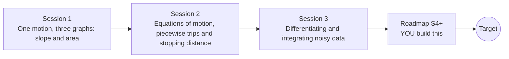

# openmotion

[](https://github.com/KrunalPanchal1995/openmotion/actions/workflows/ci.yml)   [](https://colab.research.google.com/github/KrunalPanchal1995/openmotion/blob/main/sessions/session-01/lesson.ipynb) [](https://krunalpanchal1995.github.io/openmotion/)

**Read position, velocity and acceleration graphs like a physicist, in three sessions.**

openmotion teaches how to read a moving body from its graphs: slope, area, equations of motion and, finally, velocity and acceleration recovered from noisy measurements, using only Python and a browser.

- **Start from zero.** Session 1 needs only school algebra and the idea of a graph; slope and area are explained from scratch.
- **See it move.** Every session ships a slider app that runs in the browser, with labelled graphs and live numbers.
- **Know you got it right.** Each session ends with a checkpoint that prints PASS or FAIL against hand calculations.
- **Build the missing half.** The repo stops at Session 3 on purpose; the roadmap shows the path to the Target.

[Target](#the-target) · [Who is this for](#who-is-this-for) · [Quick start](#quick-start) · [Sessions](#sessions) · [Roadmap](#roadmap) · [Contribute](#contribute) · [Explainer PDF](docs/explainer.pdf)

> **This repo is incomplete on purpose.** Sessions 1 to 3 are here and fully working. The finished Target below is a preview of what the community can build next. We show you the path, not the code. Sessions 4 and up are yours.

## The Target

A car drives a smooth trip while its position is measured with a 3 cm error. The three graphs are drawn live: the orange lines are plain finite differences of the noisy data and are unreadable (errors of 0.4 m/s and 7 m/s^2), while the recovered velocity and acceleration curves follow the exact answer to within 0.01 m/s and 0.04 m/s^2. Your goal over the coming sessions: build that recovery yourself, from your own phone data.


*Target: three live graphs and the velocity and acceleration recovered from noisy position data*


*Target, final frame: recovered curves against the unreadable plain differences*


*Too little smoothing keeps the noise, too much blurs the motion*

Try it live:

- [Math Visual Studio: kinematics (Atlas S35)](https://krunalpanchal1995.github.io/studio/#atlas?ch=S35&ex=1)
- [Math Visual Studio (all tools)](https://krunalpanchal1995.github.io/studio/)

How the Target was made is shown only as a path in [promo/roadmap.md](promo/roadmap.md).

## Who is this for
**secondary school to diploma / undergraduate (levels 3-5).** Topic area: Physics and the Science of Motion.

Prerequisites:

- Algebra with a straight line, y = m x + c, and the idea of the slope of a graph.
- Python 3.10 or newer; if `python --version` works, you are ready. PRIMER.md explains the rest.
- No prior physics, calculus or GitHub experience is needed; Session 3 explains the few calculus ideas it uses.

New to Python? Read [PRIMER.md](PRIMER.md) first (10 minutes).

## Quick start

No installation knowledge needed. You need [Git](https://git-scm.com/downloads) and [Python 3.10+](https://www.python.org/downloads/) (Windows: tick "Add Python to PATH"). On Mac and Linux type `python3` wherever this page says `python`.

```bash
git clone https://github.com/KrunalPanchal1995/openmotion.git
cd openmotion
python start.py 1
```

`start.py` creates a private environment, installs what is needed and runs Session 1 with its checkpoint. Next: `python start.py 2`, `python start.py 3`, or `python start.py test` to check everything. Only a checkpoint: `python start.py check 1`.

Four lines turn the idea of Session 1 into a result (they work as they are): Save it as `try.py` and run it with `python start.py run try.py` (this uses the private environment, where NumPy is installed):

```python
import numpy as np
t = np.arange(0, 10.01, 0.1)
x = 4 * t + t ** 2                  # start at 4 m/s with a = 2 m/s^2
v = np.gradient(x, t)               # velocity = slope of the x-t graph
print(round(v[50], 2), round(x[-1], 1))   # -> 14.0 140.0  (v at 5 s, x at 10 s)
```

Every session also opens in your browser with sliders (no install): [live apps](https://krunalpanchal1995.github.io/openmotion/). Or use the Colab badge above for the notebook.

## Sessions

| # | Session | Model level | Time | Live app |
|---|---|---|---|---|
| 1 | [One motion, three graphs: slope and area](sessions/session-01/README.md) | Level 1: conceptual interactive model | 60 min | [open](https://krunalpanchal1995.github.io/openmotion/session-01/) |
| 2 | [Equations of motion, piecewise trips and stopping distance](sessions/session-02/README.md) | Level 2: mathematical engineering model | 75 min | [open](https://krunalpanchal1995.github.io/openmotion/session-02/) |
| 3 | [Differentiating and integrating noisy data](sessions/session-03/README.md) | Level 3: simulation and validation | 90 min | [open](https://krunalpanchal1995.github.io/openmotion/session-03/) |

Each session follows the same six steps: A real-world problem, B concept and theory, C visual explanation, D interactive simulation, E worked example and experiment, F assessment and design challenge. Each ends with `checkpoint.py`, which prints `PASS` or `FAIL` against reference numbers. Session 3 also contains the real-world mini-project: **Analyse a motion recorded by a phone**.

## Architecture



| Folder or file | What is inside |
|---|---|
| `sessions/` | three sessions: README (A-F), `lesson.py`, notebook, live app, exercises, activity sheet, checkpoint |
| `promo/` | the Target: media, live links, and the roadmap (path only) |
| `docs/` | `explainer.tex` and the built `explainer.pdf` |
| `tests/` | runs every lesson and checkpoint headless |
| `start.py` | one command to set up and run anything |
| `QUALITY.md`, `RUBRIC.md` | the quality checklist and the scoring rubric |
| `.github/` | CI, PDF build, Pages deploy, issue and PR templates |

## Roadmap

| Milestone | What you will build | Difficulty |
|---|---|---|
| Session 4: Fit the pieces, not the points | A change-point fit of the three pieces of a noisy trip. | intermediate |
| Session 5: Let the data choose the window | A function that picks the smoothing window without knowing the true motion. | advanced |
| Session 6: Error bars on velocity | A 95 percent interval drawn around the recovered velocity. | advanced |
| Session 7: Your own phone recording | A recording of a rolling trolley analysed end to end. | intermediate |
| Session 8: A tossed ball in two dimensions | The analysis of a ball toss filmed side-on. | advanced |

Full detail with a checkpoint per milestone: [promo/roadmap.md](promo/roadmap.md).

## Contribute
New to GitHub? Read [CONTRIBUTING.md](CONTRIBUTING.md); it starts from zero. Pick an issue labelled `good first issue`. Translations into Hindi, Telugu, Tamil and Malayalam are welcome.

<details>
<summary>Development</summary>

```bash
python start.py test        # runs every lesson and checkpoint
```
Lessons use `# %%` cell markers so they open as notebooks in VS Code. See [QUALITY.md](QUALITY.md) for the standard every session meets.
</details>

## License
MIT. See [LICENSE](LICENSE). Media in `promo/media` is (c) Krunal Panchal, CC BY 4.0.

## Acknowledgments
Part of the [PAN IIT OSS](https://hellofoss.tech-iitb.org/projects) open-source teaching collection, modelled on the structure of [openspline](https://github.com/openspline/openspline). Built on ideas from the Math Visual Studio at https://krunalpanchal1995.github.io/studio/.
