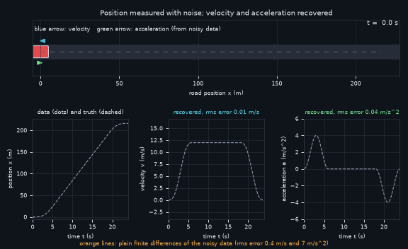
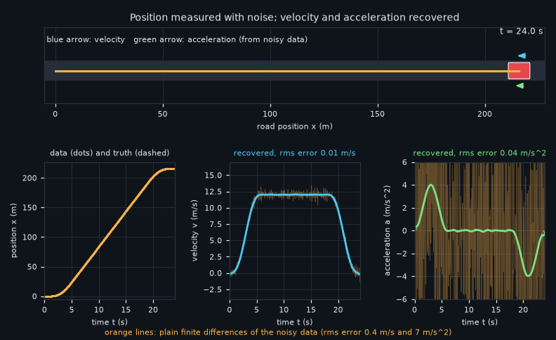
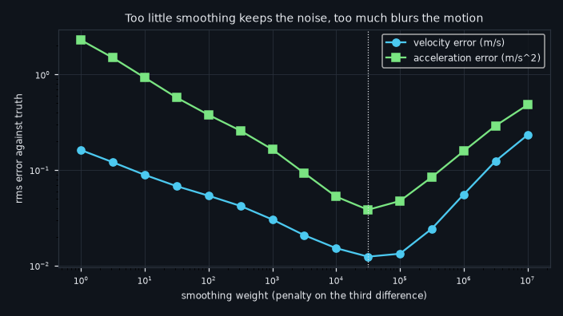

# What you are building toward

A car drives a smooth trip while its position is measured with a 3 cm error. The three graphs are drawn live: the orange lines are plain finite differences of the noisy data and are unreadable (errors of 0.4 m/s and 7 m/s^2), while the recovered velocity and acceleration curves follow the exact answer to within 0.01 m/s and 0.04 m/s^2. Your goal over the coming sessions: build that recovery yourself, from your own phone data.

*Target: three live graphs and the velocity and acceleration recovered from noisy position data*

*Target, final frame: recovered curves against the unreadable plain differences*

*Too little smoothing keeps the noise, too much blurs the motion*

These results come from a private reference build. The code is not published; the roadmap shows the path so you can build your own.

Live links:

- [Math Visual Studio: kinematics (Atlas S35)](https://krunalpanchal1995.github.io/studio/#atlas?ch=S35&ex=1)
- [Math Visual Studio (all tools)](https://krunalpanchal1995.github.io/studio/)
