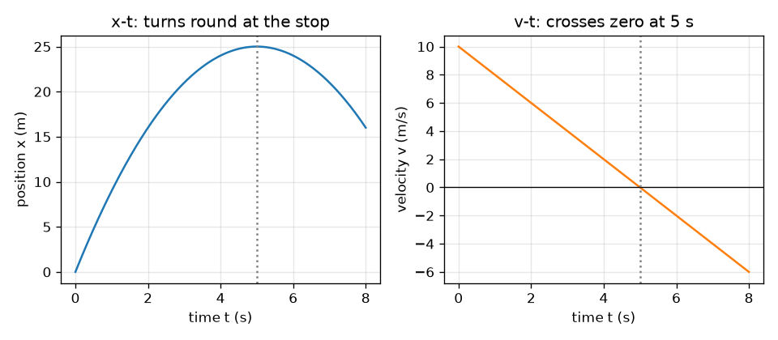
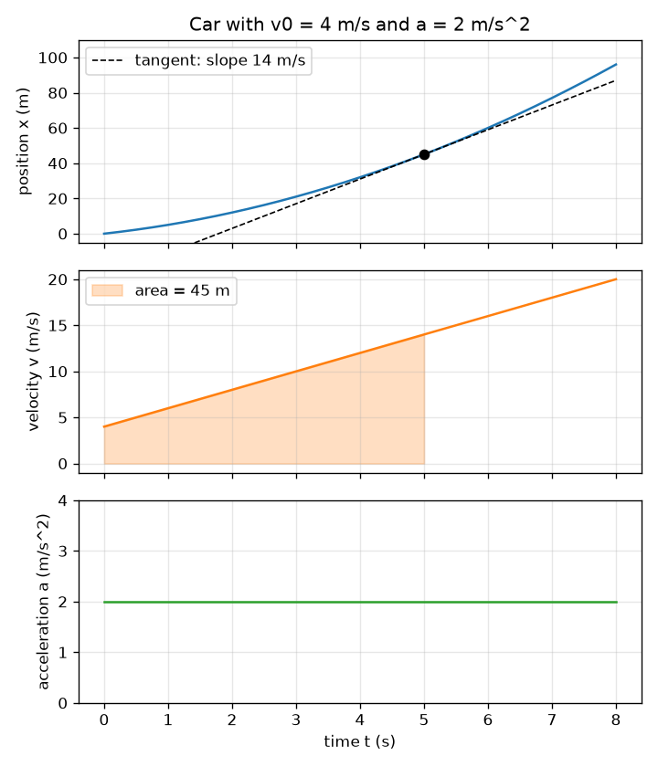

# Session 1: One motion, three graphs: slope and area

*Level 1 (conceptual interactive model) · about 60 minutes · openmotion*

> This is a simplified educational model. It is not a validated design tool and must not be used for real structures, electrical installations, vehicles, industrial processes or medical decisions.

**Prerequisites**

- The idea of a graph and of the slope of a straight line.
- You have read PRIMER.md and run `python start.py 1` once.

**Learning objectives.** After this session you can:

- Name position, velocity and acceleration and give their units.
- Explain that the slope of an x-t graph is velocity and the slope of a v-t graph is acceleration.
- Explain that the area under a v-t graph is the distance moved (displacement).
- Use v = v0 + a t and x = x0 + v0 t + (1/2) a t^2 for a constant acceleration, by hand and in Python.

## A. Real-world problem
A car pulls away from a junction. A speed camera records where it is, and you want to know how fast it was going and whether it was speeding up or slowing down. You cannot see speed in a list of positions, but you can see it in a graph: a steep position graph means fast. Why? And if someone gives you only the speed graph, can you work out how far the car went?

## B. Concept and theory
Position x is where the body is along a line (metres). Velocity v is how fast x changes, including direction (metres per second): it is the slope of the x-t graph. Acceleration a is how fast v changes (metres per second squared): it is the slope of the v-t graph. In the other direction, the area between the v-t graph and the time axis is the displacement, and the area under the a-t graph is the change of velocity. Area below the axis counts as negative (motion backwards). For a constant acceleration the three graphs are a parabola, a straight line and a flat line.

| Symbol | Meaning | Unit |
|---|---|---|
| t | time | s |
| x0 | starting position (0 in this session) | m |
| x | position at time t | m |
| v0 | velocity at t = 0 | m/s |
| v | velocity at time t | m/s |
| a | acceleration (constant) | m/s^2 |

**Assumptions**

- The car moves along one straight line; positive is forward.
- The acceleration is constant for the whole time.
- The car is treated as a single point.

$$ a(t)=a,\qquad v(t)=v_0+a\,t,\qquad x(t)=x_0+v_0\,t+\tfrac12 a\,t^2 $$

$$ v=\frac{dx}{dt},\qquad a=\frac{dv}{dt} $$

$$ \Delta x=\int_0^t v\,dt',\qquad \Delta v=\int_0^t a\,dt' $$

## C. Visual explanation
The first figure stacks the three graphs of a car with v0 = 4 m/s and a = 2 m/s^2 on one time axis. The dashed tangent on the x-t graph at 5 s has a slope of 14 m/s, equal to the height of the v-t graph at that moment; the shaded area under v-t up to 5 s is 45 m, the height of the x-t graph at 5 s. The second figure shows braking from 10 m/s at -2 m/s^2: the v-t line crosses zero at 5 s, and at that moment the x-t curve turns round at 25 m.

*Braking from 10 m/s at -2 m/s^2: the car stops at 5 s and 25 m, and would then reverse.*

*One car, three linked graphs: the tangent slope is 14 m/s and the shaded area is 45 m at 5 s.*

## D. Interactive simulation
Run the lesson (`python start.py 1`), then open the live app: [Session 1: a car and its three graphs](https://krunalpanchal1995.github.io/openmotion/session-01/) (or `app.html` in this folder). Move the sliders and watch the car, then flip through the position, velocity and acceleration views. The dashed line on the x-t graph is the tangent; its slope is the velocity. The shaded region in the v-t view is the distance moved.

**Challenge.** Make the car end at rest (velocity within 0.2 m/s of zero) after it has moved more than 20 m.

## E. Worked example and experiment
**Problem.** A car starts at x = 0 with v0 = 4 m/s and accelerates at 2 m/s^2. Find its velocity and position after 5 s, then check the answers with the slope and the area.

1. Velocity: v = v0 + a t = 4 + 2 * 5 = 14 m/s.
2. Position: x = v0 t + (1/2) a t^2 = 4 * 5 + 0.5 * 2 * 25 = 20 + 25 = 45 m.
3. Slope check: the slope of the x-t curve at 5 s should be the velocity. A step of 0.001 s either side gives (x(5.001) - x(4.999)) / 0.002 = 14 m/s.
4. Area check: the v-t graph from 0 to 5 s is a trapezoid with parallel sides 4 and 14 m/s and width 5 s: area = (4 + 14) / 2 * 5 = 45 m. The two methods agree.

**Answer.** v = 14 m/s and x = 45 m after 5 s; the slope of x-t is 14 m/s and the area under v-t is 45 m.

**Experiment.** Roll a toy car down a gentle slope past a ruler taped to the table, film it with a phone at 30 frames per second, and read the car position every few frames. Plot x against t and compare the shape with a parabola. Differences between model and measurement come from friction (the acceleration is not exactly constant), from reading the frames (a few millimetres), and from the timing of the camera: the model has a perfect constant acceleration, the toy car does not.

## F. Assessment and design challenge
**Question type A: Conceptual.** What does the slope of a position-time graph represent? What does a negative slope mean, and what does a flat part mean?

Hint

Slope is rise over run. What is the rise and what is the run?

Step-by-step solution

The rise is a change of position and the run is a change of time, so the slope is change of position per unit time: the velocity. A negative slope means the position is decreasing, so the body moves backwards (opposite to the positive direction). A flat part has zero slope: the body is at rest.

**Question type B: Numerical.** A car has v0 = 3 m/s and a = 2.5 m/s^2. Find its velocity and the distance it has moved after 4 s. Check the units and that the answer is sensible.

Hint

Use v = v0 + a t and x = v0 t + (1/2) a t^2.

Step-by-step solution

v = 3 + 2.5 * 4 = 13 m/s. x = 3 * 4 + 0.5 * 2.5 * 16 = 12 + 20 = 32 m. Units: (m/s)(s) = m and (m/s^2)(s^2) = m. Sanity check: the average velocity is (3 + 13) / 2 = 8 m/s, and 8 m/s * 4 s = 32 m. The numbers agree.

**Question type C: Graph and simulation interpretation.** A v-t graph is a straight line from (0 s, 12 m/s) down to (6 s, 0 m/s). In which direction is the acceleration, what is its value, and how far did the body move?

Hint

The slope gives the acceleration; the area of the triangle gives the distance.

Step-by-step solution

The line goes down, so the acceleration is negative (the body is slowing down while moving forward): a = (0 - 12) / 6 = -2 m/s^2. The area is a triangle: 0.5 * 6 s * 12 m/s = 36 m. The body moved 36 m forward and stopped.

**Question type D: Design and optimisation challenge.** Design: a car travelling at 10 m/s must stop within 30 m. What constant deceleration is needed at least, and how long does the stop take? State your assumptions.

Hint

The v-t graph is a triangle with area equal to the stopping distance.

Step-by-step solution

The area of the triangle is 0.5 * 10 * T = 30, so T = 6 s and the deceleration is 10 / 6 = 1.67 m/s^2 (a bit more would be safer). Check: the 'no time' formula gives v^2 / (2 d) = 100 / 60 = 1.67 m/s^2. Assumptions: constant deceleration from the first instant, a straight road, no reaction time (Session 2 adds it).

Score yourself with [RUBRIC.md](../../RUBRIC.md). Print the [activity sheet](activity_sheet.md) to work on paper.

## Common misconceptions
| Common misconception | What is actually true |
|---|---|
| Negative acceleration always means the body is slowing down. | It means the velocity is decreasing. If the velocity is negative, a negative acceleration makes the body speed up backwards. |
| If the velocity is zero, the acceleration must be zero. | At the top of a thrown ball the velocity is zero for an instant but the acceleration is still 9.8 m/s^2 downwards. Zero velocity with a nonzero acceleration is a turning point. |
| The graph of x against t is the path of the car. | The x-t graph shows where the car is at each time, not the shape of the road. A car on a straight road gives a curved x-t graph when it speeds up. |

## Glossary
- **position**: where a body is along a line, measured from a starting point
- **velocity**: rate of change of position, with direction; the slope of the x-t graph
- **acceleration**: rate of change of velocity; the slope of the v-t graph
- **displacement**: change of position; the signed area under the v-t graph
- **slope**: rise divided by run of a graph

## Finish
1. Do the three coding tasks in [exercises.md](exercises.md).
2. Run `python start.py 1` again after your changes. It ends with the checkpoint; when it prints `PASS`, you are done. (Checkpoint only: `python start.py check 1`.)

Next: [Session 2](../session-02/README.md)
