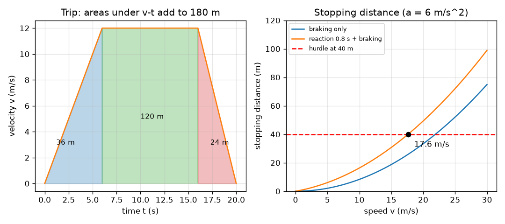

# Session 2: Equations of motion, piecewise trips and stopping distance

*Level 2 (mathematical engineering model) · about 75 minutes · openmotion*

> This is a simplified educational model. It is not a validated design tool and must not be used for real structures, electrical installations, vehicles, industrial processes or medical decisions.

**Prerequisites**

- Session 1: slope and area of the motion graphs.
- Solving a quadratic equation is helpful and is explained in Section E.

**Learning objectives.** After this session you can:

- Use the three equations of motion for a constant acceleration, including the one without time.
- Build a trip from pieces (speed up, cruise, brake) and read its displacement as area under the v-t graph.
- Identify the intervals of speeding up, cruising and slowing down from a graph.
- Solve a stopping-distance design problem, including its inverse (the largest safe speed).

## A. Real-world problem
A driver sees a hurdle 40 m ahead while the car is doing 20 m/s (72 km/h). The driver needs about a second to react, and the brakes then need distance to work. Does the car stop in time? If not, how fast would it be going when it hits, and what is the fastest speed that would still be safe? This lesson is a simplified model for learning, with constant braking on a dry flat road; real stopping distances depend on tyres, road, load and driver, and the lesson must never be used to decide how to drive.

## B. Concept and theory
For a constant acceleration a, three equations connect v0, v, a, t and the displacement dx. Eliminating t gives v^2 = v0^2 + 2 a dx, which links speed and distance directly. A stop from speed v at deceleration a (a positive number) takes dx = v^2 / (2 a): doubling the speed quadruples the braking distance. During the reaction time t_r the car keeps its speed and covers v t_r. A trip is solved piece by piece: the final velocity and position of one piece are the start of the next, and the total displacement is the total area under the v-t graph.

| Symbol | Meaning | Unit |
|---|---|---|
| v0, v | starting and final velocity | m/s |
| a | acceleration (deceleration in the braking formulas, as a positive number) | m/s^2 |
| dx | displacement | m |
| t_r | driver reaction time | s |
| D | distance to the hurdle | m |
| v_c | cruise speed of a trip | m/s |

**Assumptions**

- Straight road, constant acceleration in each piece.
- Reaction time is a pure delay at constant speed, then full braking at once.
- Braking deceleration stays constant; no change of grip, no slope, no wind.
- Educational model only; it is not a safety calculation.

$$ v=v_0+a\,t,\qquad \Delta x=v_0 t+\tfrac12 a t^2,\qquad v^2=v_0^2+2a\,\Delta x $$

$$ d_{stop}=v\,t_r+\frac{v^2}{2a} $$

$$ v_{max}=a\left(-t_r+\sqrt{t_r^2+\frac{2D}{a}}\right) $$

## C. Visual explanation
The left figure is the v-t graph of a trip: speed up for 6 s, cruise for 10 s, brake for 4 s. The three shaded areas are 36 m, 120 m and 24 m and add up to the 180 m shown by the whole graph. The right figure plots stopping distance against speed for a braking deceleration of 6 m/s^2: the braking-only curve is a parabola, the curve with a 0.8 s reaction time lies above it, and it crosses the red 40 m hurdle line at 17.6 m/s.

*Left: the areas under the v-t graph of a trip add up to 180 m. Right: stopping distance against speed, and the largest safe speed for a 40 m hurdle.*

## D. Interactive simulation
Run the lesson (`python start.py 2`), then open the live app: [Session 2: stop before the hurdle](https://krunalpanchal1995.github.io/openmotion/session-02/) (or `app.html` in this folder). Change the speed, the reaction time and the braking deceleration. Watch the grey reaction zone and the blue braking zone on the road, then open the graphs and see where the distance curve meets the hurdle line.

**Challenge.** Choose settings with a speed of at least 20 m/s that still stop with at least 2 m to spare before the hurdle at 40 m.

## E. Worked example and experiment
**Problem.** A trip: speed up from rest at 2 m/s^2 to 12 m/s, cruise for 10 s, then brake to rest at 3 m/s^2. Find the time and distance of each piece, the total distance and the average speed.

1. Speeding up: t1 = v_c / a = 12 / 2 = 6 s; distance = 0.5 * 12 * 6 = 36 m (area of a triangle).
2. Cruising: distance = 12 * 10 = 120 m (area of a rectangle), taking 10 s.
3. Braking: t3 = 12 / 3 = 4 s; distance = 0.5 * 12 * 4 = 24 m.
4. Total distance = 36 + 120 + 24 = 180 m in 6 + 10 + 4 = 20 s.
5. Average speed = 180 / 20 = 9 m/s, lower than the cruise speed because of the slow ends.
6. Intervals of acceleration from the graph: positive (+2 m/s^2) from 0 to 6 s, zero from 6 to 16 s, negative (-3 m/s^2) from 16 to 20 s.

**Answer.** 180 m in 20 s, average speed 9 m/s; accelerating 0 to 6 s, cruising 6 to 16 s, braking 16 to 20 s.

**Experiment.** Walk along a corridor with a marked floor and a phone timer: speed up, walk steadily, slow down, and record the time at each metre mark. Plot x-t and compare the three pieces with the model. A person does not change speed in sharp corners; the real v-t graph has rounded corners, which is the main difference from the model with its sudden changes of acceleration.

## F. Assessment and design challenge
**Question type A: Conceptual.** Why does the braking distance grow with the square of the speed, while the reaction distance grows only in proportion to it? What happens to the braking distance if the speed doubles?

Hint

Compare v t_r with v^2 / (2 a).

Step-by-step solution

During the reaction time the car moves at constant speed, so the distance is speed times time: proportional to v. Braking removes speed at a fixed rate, so a faster car takes longer to stop and also covers more distance every second: the distance is v^2 / (2 a). Doubling the speed doubles the reaction distance but multiplies the braking distance by 4.

**Question type B: Numerical.** A car at 15 m/s brakes with a deceleration of 5 m/s^2. Find the braking time and distance. If the driver also takes 1.0 s to react, what is the total stopping distance?

Hint

t = v / a, and dx = v^2 / (2 a).

Step-by-step solution

Braking time = 15 / 5 = 3 s. Braking distance = 15^2 / (2 * 5) = 225 / 10 = 22.5 m. Reaction distance = 15 * 1.0 = 15 m. Total = 37.5 m. Sanity check: the average speed while braking is 7.5 m/s, and 7.5 * 3 = 22.5 m.

**Question type C: Graph and simulation interpretation.** Using the stopping-distance graph (reaction time 0.8 s, a = 6 m/s^2), at what speed does the car just stop at the 40 m hurdle? At 20 m/s, which is larger, the reaction distance or the braking distance?

Hint

Find where the upper curve meets the red line; then compare 20 * 0.8 with 400 / 12.

Step-by-step solution

The curve meets the 40 m line at about 17.6 m/s (63.5 km/h). At 20 m/s the reaction distance is 20 * 0.8 = 16 m and the braking distance is 400 / 12 = 33.3 m, so braking is the larger part, and the total is 49.3 m, over the hurdle by 9.3 m.

**Question type D: Design and optimisation challenge.** Design: the hurdle is 40 m away and the braking deceleration cannot exceed 6 m/s^2. Find the largest safe speed for a reaction time of 0.8 s, and for a quicker driver with 0.5 s. What does the comparison tell you about the design?

Hint

Solve v t_r + v^2 / (2 a) = D for v: v = a (-t_r + sqrt(t_r^2 + 2 D / a)).

Step-by-step solution

For t_r = 0.8 s: v = 6 * (-0.8 + sqrt(0.64 + 13.33)) = 6 * (-0.8 + 3.738) = 17.63 m/s. For t_r = 0.5 s: v = 6 * (-0.5 + sqrt(0.25 + 13.33)) = 6 * (-0.5 + 3.685) = 19.11 m/s. Trade-off: 0.3 s less reaction time buys about 1.5 m/s of speed, but no reaction time can make 20 m/s safe with 6 m/s^2 over only 40 m (braking alone needs 33.3 m, leaving just 6.7 m for reaction = 0.33 s). Design options: a lower speed limit, an earlier warning sign, or better brakes. Assumption: constant braking on a dry road.

Score yourself with [RUBRIC.md](../../RUBRIC.md). Print the [activity sheet](activity_sheet.md) to work on paper.

## Common misconceptions
| Common misconception | What is actually true |
|---|---|
| Stopping distance is just the braking distance. | The driver also covers distance during the reaction time; at 20 m/s and 0.8 s that is 16 m, almost a third of the total. |
| Doubling the speed doubles the stopping distance. | The braking part grows with the square of the speed: it becomes four times longer. |
| The average speed of a trip is the cruise speed. | Average speed is total distance over total time; the slow speeding-up and braking pieces pull it down (9 m/s against 12 m/s in the worked example). |

## Glossary
- **reaction time**: delay between seeing a danger and starting to brake, during which speed stays constant
- **deceleration**: acceleration that reduces speed; written here as a positive number a
- **piecewise motion**: motion described by different formulas in successive time intervals
- **stopping distance**: reaction distance plus braking distance
- **average speed**: total distance divided by total time

## Finish
1. Do the three coding tasks in [exercises.md](exercises.md).
2. Run `python start.py 2` again after your changes. It ends with the checkpoint; when it prints `PASS`, you are done. (Checkpoint only: `python start.py check 2`.)

Next: [Session 3](../session-03/README.md)
