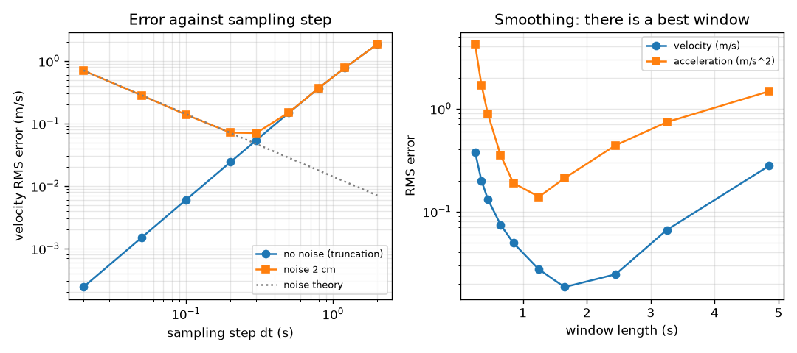
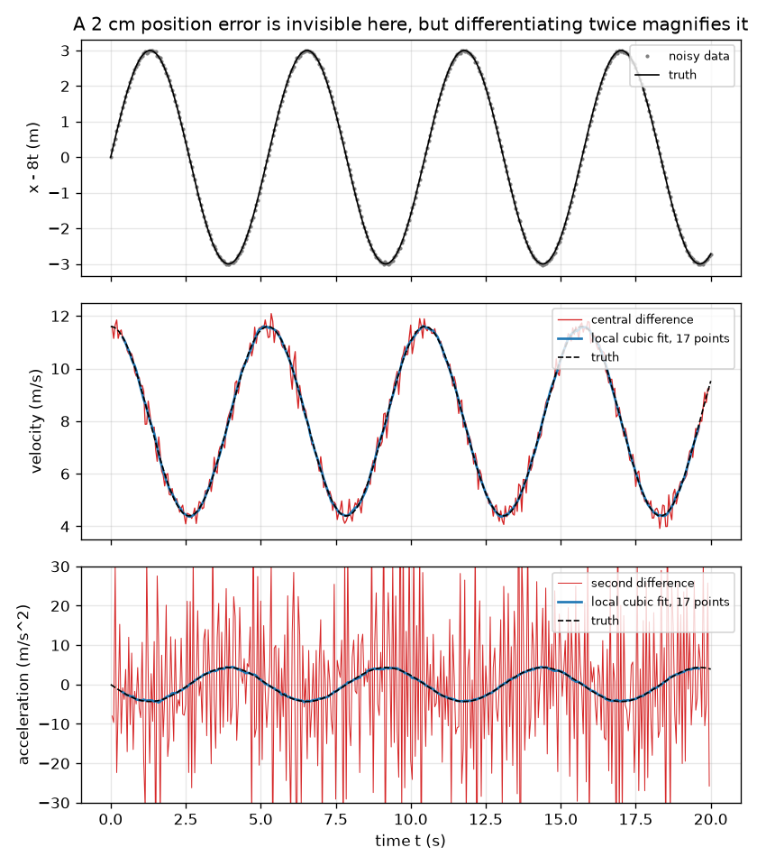

# Session 3: Differentiating and integrating noisy data

*Level 3 (simulation and validation) · about 90 minutes · openmotion*

> This is a simplified educational model. It is not a validated design tool and must not be used for real structures, electrical installations, vehicles, industrial processes or medical decisions.

**Prerequisites**

- Session 1: slope and area.
- Session 2: equations of motion.

**Learning objectives.** After this session you can:

- Estimate velocity and acceleration from sampled positions with finite differences.
- Predict how measurement noise and the sampling step change the error, and check it against a known motion.
- Use a local polynomial fit to differentiate while smoothing, and choose its window.
- Explain why integrating is safe but differentiating magnifies noise, and find the limit where sampling is too coarse.

## A. Real-world problem
A phone camera or a GPS gives you positions at fixed time steps, each a little wrong. You want velocity and acceleration, which are slopes of slopes. A tiny error of 2 cm in position becomes an error of 0.3 m/s in velocity and almost 20 m/s^2 in acceleration, more than the real acceleration. How can we tame this, and how do we know the answer is right? We test every method on a motion whose exact answer we know. This is a simplified model of measurement noise and is for learning.

## B. Concept and theory
Sampled positions x_i are taken every dt seconds. The centred difference (x[i+1] - x[i-1]) / (2 dt) estimates the velocity and the second difference (x[i+1] - 2 x[i] + x[i-1]) / dt^2 the acceleration. Two errors appear. Truncation error comes from the formula itself and shrinks like dt^2. Noise error comes from random errors in x: if each x has standard deviation sigma, the velocity error is about sigma / (sqrt(2) dt) and the acceleration error about sqrt(6) sigma / dt^2, so smaller dt makes noise worse. Fitting a cubic polynomial to the 2h + 1 samples around each point and using the slope or curvature of the fit averages many samples and cuts the noise, at the price of blurring real changes if the window is too wide. Integration goes the other way: adding up many samples averages the noise out.

| Symbol | Meaning | Unit |
|---|---|---|
| dt | time between samples | s |
| sigma | standard deviation of the position noise | m |
| x_i | measured position of sample i | m |
| h | half window: the fit uses 2h + 1 samples | samples |
| v_est, a_est | estimated velocity and acceleration | m/s, m/s^2 |
| RMS error | square root of the mean squared difference from the exact value | same as the quantity |

**Assumptions**

- Noise is random, independent between samples, with mean 0 and constant sigma.
- The time stamps are exact.
- The exact motion is x(t) = 8 t + 3 sin(1.2 t), so v(t) = 8 + 3.6 cos(1.2 t) and a(t) = -4.32 sin(1.2 t).
- A cubic local fit is flexible enough for this smooth motion; sharp corners are not.

$$ v_i\approx\frac{x_{i+1}-x_{i-1}}{2\,\Delta t},\qquad a_i\approx\frac{x_{i+1}-2x_i+x_{i-1}}{\Delta t^2} $$

$$ \sigma_v\approx\frac{\sigma}{\sqrt2\,\Delta t},\qquad \sigma_a\approx\frac{\sqrt6\,\sigma}{\Delta t^2} $$

$$ \left|v_i-v(t_i)\right|\le\frac{\Delta t^2}{6}\max|x'''|\quad\text{(no noise)} $$

## C. Visual explanation
The first figure shows the exact velocity and acceleration (black dashed) with the noisy finite differences (red) and the local cubic fit (blue), for dt = 0.05 s and sigma = 2 cm. The red acceleration swings between about -72 and +69 m/s^2 while the true wiggle is 4.32 m/s^2; the blue curve follows the truth. The second figure shows, on the left, the velocity error against the sampling step: noise dominates for small dt (error falls as 1/dt), truncation for large dt (error rises as dt^2), with a best step near 0.3 s. On the right it shows the error against the window length for the local fit: too short keeps the noise, too long blurs; the acceleration error is lowest near a 1.25 s window.

*Velocity error against the sampling step (left) and against the smoothing window (right).*

*Exact motion (black), plain finite differences (red) and a local cubic fit (blue) from noisy positions.*

## D. Interactive simulation
Run the lesson (`python start.py 3`), then open the live app: [Session 3: velocity and acceleration from noisy positions](https://krunalpanchal1995.github.io/openmotion/session-03/) (or `app.html` in this folder). Change the sampling step, the noise and the half window. First set the noise to zero and see that all methods are exact; then raise it and watch the red curves explode while the blue curves stay calm. Open the bar view to compare the errors as a fraction of the true wiggle.

**Challenge.** With noise of at least 0.03 m, choose a smoothing window between 1 and 2.5 seconds long, so that the blue acceleration follows the exact curve.

## E. Worked example and experiment
**Problem.** For dt = 0.05 s and sigma = 0.02 m, predict the velocity and acceleration errors of plain finite differences, then measure them on simulated data, then smooth with a 17-point cubic fit (h = 8).

1. Predicted velocity error: sigma / (sqrt(2) dt) = 0.02 / (1.414 * 0.05) = 0.283 m/s.
2. Predicted acceleration error: sqrt(6) sigma / dt^2 = 2.449 * 0.02 / 0.0025 = 19.6 m/s^2, which is 4.5 times the real wiggle of 4.32 m/s^2.
3. Measured on 401 simulated samples (seed 1): velocity RMS error 0.274 m/s and acceleration RMS error 19.24 m/s^2, within 10 percent of the predictions.
4. Truncation check without noise: the error stays below dt^2 / 6 * 3 * 1.2^3 = 0.00216 m/s (measured largest error 0.00216 m/s, just under the bound).
5. Smoothing with h = 8 (window 0.85 s): velocity error 0.040 m/s and acceleration error 0.16 m/s^2, about 7 and 120 times smaller.

**Answer.** Plain differences: 0.28 m/s and 19.6 m/s^2 predicted, 0.27 m/s and 19.2 m/s^2 measured. A 17-point cubic fit cuts them to 0.04 m/s and 0.16 m/s^2.

**Experiment.** Record a toy car rolling past a ruler at 30 frames per second, read x in every frame, and estimate v and a with both methods. You have no exact answer, so test the method another way: record the same motion twice and compare, or compare the cruise speed with distance over time from a stopwatch. Real data differ from the model because the noise may be correlated (a bad frame ruler reading affects neighbours), because the timing of the camera is not perfectly regular, and because the real motion has corners that a polynomial fit blurs.

## Real-world application and mini-project: Analyse a motion recorded by a phone
Film a trolley, a toy car or a person walking past a ruler with your phone (30 frames per second is typical), and read its position from the frames, or log positions with any phone app you like. Start with the synthetic example `phone_dataset()` in Session 3: a trolley that speeds up, cruises and brakes, filmed at 30 frames per second with 2 cm position error. Estimate its velocity and acceleration with `smooth_derivative`, choose the window yourself, and then repeat with your own recording.

**Deliverable:** A script that loads the positions, prints the cruise speed, the displacement found by integrating the estimated velocity and the intervals of positive, zero and negative acceleration, and saves a three-panel picture (x-t, v-t, a-t).

**Success looks like:** On the synthetic example: the cruise speed (mean velocity between 8 s and 14 s) is within 0.1 m/s of 12 m/s, the displacement from integrating the estimated velocity is within 1 m of 180 m, and the estimated acceleration is clearly positive at 3 s and clearly negative at 18 s.

## F. Assessment and design challenge
**Question type A: Conceptual.** Why is differentiating noisy data much worse than integrating it? Explain with one sentence about what each operation does to random errors.

Hint

Think of a slope between two points that are close together, and of a sum of many points.

Step-by-step solution

A slope divides the difference of two noisy numbers by a small time step, so the error is magnified by roughly 1/dt, and taking a slope again magnifies it by another 1/dt. Integrating adds many samples times dt, and random errors of both signs partly cancel, so the total error grows slowly. In the lesson, integrating a velocity with 0.2 m/s noise over 20 s left a position error of only 0.12 m.

**Question type B: Numerical.** For sigma = 0.02 m, predict the noise errors of the velocity and the acceleration if the sampling step is halved from 0.05 s to 0.025 s. By what factors do they change?

Hint

Use sigma / (sqrt(2) dt) and sqrt(6) sigma / dt^2.

Step-by-step solution

Velocity: 0.02 / (1.414 * 0.025) = 0.566 m/s, twice as large as 0.283. Acceleration: 2.449 * 0.02 / 0.000625 = 78.4 m/s^2, four times as large as 19.6. Halving dt makes the noise worse by a factor 2 for v and 4 for a. Sanity check: both errors scale with a negative power of dt.

**Question type C: Graph and simulation interpretation.** On the error-against-step graph (velocity, central difference), why does the noisy curve have a minimum near dt = 0.3 s? What happens at dt = 2 s even without noise?

Hint

Two error sources compete. Which one wins at small dt and which at large dt?

Step-by-step solution

Noise error falls like 1/dt and truncation error rises like dt^2; they are equal where 0.02 / (1.414 dt) = 0.61 dt^2, i.e. dt = 0.28 s, so the sum is smallest near 0.3 s (0.070 m/s measured). At dt = 2 s the sampling is nearly as slow as the 5.2 s wiggle of the motion, so a centred difference misses it: the velocity error is 1.85 m/s even with no noise at all. This is the sampling limit.

**Question type D: Design and optimisation challenge.** Design: with sigma = 0.02 m and dt = 0.05 s, choose a window length for the local cubic fit so that the acceleration error is below 0.5 m/s^2. Which windows work, and what is the trade-off?

Hint

Use the table printed by the lesson (error against half window).

Step-by-step solution

From the lesson table (average of 10 noise seeds), windows from about 0.65 s (error 0.35 m/s^2) to 2.45 s (0.44 m/s^2) are under 0.5; the best is near 1.25 s (0.14 m/s^2). Shorter windows keep the noise (0.25 s gives 4.2 m/s^2), longer ones blur the real 5.2 s wiggle (4.85 s gives 1.5 m/s^2). A window of about 1.25 s, the quarter of the wiggle period, is a good choice. Trade-off: a wide window is calm but would blur the sharp corners of a trip. Assumption: smooth motion and independent noise.

Score yourself with [RUBRIC.md](../../RUBRIC.md). Print the [activity sheet](activity_sheet.md) to work on paper.

## Common misconceptions
| Common misconception | What is actually true |
|---|---|
| A smaller time step always gives a better velocity estimate. | Only without noise. With noise, a smaller step magnifies it: halving dt doubles the velocity error and quadruples the acceleration error. |
| Smoothing always improves the result. | A window that is too wide flattens real changes. The error against window length has a minimum. |
| If the position graph looks clean, the acceleration will too. | A 2 cm error is invisible on a 160 m graph but produces acceleration errors of 19 m/s^2 after two differentiations. |

## Glossary
- **finite difference**: a slope or curvature estimated from neighbouring samples
- **noise**: random error in a measurement
- **truncation error**: error from the approximation formula itself, even without noise
- **RMS error**: root-mean-square difference between an estimate and the exact value
- **local polynomial fit**: fitting a short polynomial around each point and reading its slope or curvature
- **window**: the samples used around each point

## Finish
1. Do the three coding tasks in [exercises.md](exercises.md).
2. Run `python start.py 3` again after your changes. It ends with the checkpoint; when it prints `PASS`, you are done. (Checkpoint only: `python start.py check 3`.)

Next: the [roadmap](../../promo/roadmap.md). Session 4 is yours to build.
